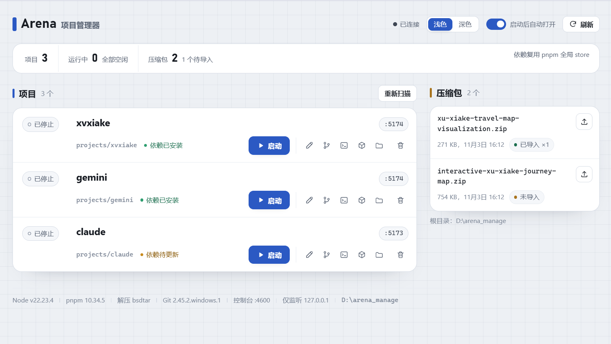

# Arena 项目管理器

一个**零第三方依赖**的本地管理台，用来管理从大模型竞技场下载的 React / Vite 项目压缩包：

> 自动解压 → 自动安装依赖 → 一键启动 / 停止 → 实时日志

整个管理系统只有两个文件：`arena-manager.mjs`（Node 内置模块实现的本地服务）和 `public/index.html`（单文件界面），不需要构建，也不需要额外安装任何管理端依赖。



> 界面预览：项目列表、运行状态、端口与压缩包扫描一目了然，支持浅色 / 深色主题。

---

## 快速开始

1. 双击 **`start-manager.cmd`**，会自动打开浏览器。
2. 或者在终端执行：

   ```cmd
   node arena-manager.mjs --open
   ```

3. 控制台地址：<http://127.0.0.1:4600/>（端口被占用时会自动顺延到 4601–4609）。

把 `.zip` 压缩包放到本目录，刷新页面即可看到；点击「导入」后会自动解压、安装依赖。导入弹窗默认勾选「安装完成后自动启动」，一次点击就能完成 **解压 → 建立 Git 仓库 → 安装 → 启动 → 分配端口**，随后在日志窗口里点「打开页面」即可。

> 自动启动偏好会记录在浏览器本地；取消勾选则导入后只安装依赖，之后手动启动。

**重复双击不会启动第二个实例**：检测到已有管理器时，会直接打开现有控制台。
**退出方式**：先在页面点「全部停止」，再在管理窗口按 `Ctrl+C` 或关闭窗口。管理器会尽力停止所有已启动的项目。

---

## 功能

| 功能 | 说明 |
| --- | --- |
| 压缩包扫描 | 自动扫描根目录下的 `.zip`，显示大小、时间和导入次数 |
| 安全解压 | 解压前校验条目，拒绝绝对路径和 `..` 路径穿越；每个项目解压到独立目录 |
| 自动安装 | 导入后自动安装依赖；可勾选「安装完成后自动启动」，实现一键解压 → 安装 → 启动 |
| 一键启停 | 启动约 2 秒；停止会结束整个进程树（Windows `taskkill /T /F`） |
| 端口管理 | 项目从 5173 起自动分配空闲端口，并记住上次使用的端口 |
| 实时日志 | 安装与运行日志通过 SSE 实时推送，日志同时落盘到 `data/logs/` |
| Git 版本管理 | 导入时自动初始化本地仓库并创建初始提交；卡片上的 Git 按钮可查看更改、提交全部修改、浏览最近提交 |
| 其他操作 | 重命名、打开页面、打开项目目录、删除项目、全部停止、重新扫描 |
| 手工项目 | 直接把已有项目文件夹放进 `projects/`，点「重新扫描」即可纳入管理 |

---

## 依赖复用机制（重点）

### 使用 pnpm（默认，推荐）

- 所有项目共享 **pnpm 全局 store**（本机当前为 `D:\.pnpm-store`）。
- 相同的包只会下载一次；后续项目安装时通过**硬链接**复用，不重复下载、不重复占磁盘。
- 如果压缩包内自带 `package-lock.json`，会先执行 `pnpm import` 转成 pnpm lock，保证版本与压缩包一致。
- **不会修改项目源码**：原 `package-lock.json` 保留，只额外生成 `pnpm-lock.yaml`；项目自身仍然是标准的 React / Vite 工程，随时可以用 npm 手动安装。
- 每个项目仍然有自己独立的 `node_modules` 和 Vite 缓存，运行时互不干扰。
- 安装任务串行执行，避免多个 pnpm 进程同时写 store。

### 没有 pnpm 时回退到 npm

- 使用本目录下的 `.cache/npm` 作为共享缓存，同样避免重复下载。
- npm 仍会解包到各项目的 `node_modules`，速度略慢于 pnpm 的硬链接方案。

> 实测：本目录中的两个压缩包第一次安装分别约 3–5 秒完成包链接（不含 lock 转换的网络解析时间），绝大部分依赖直接来自 store。启动耗时约 1.6–2.0 秒。

---

## 目录结构

```
arena_manage/
├─ arena-manager.mjs       管理服务（零依赖，仅用 Node 内置模块）
├─ public/
│  └─ index.html           管理界面（单文件，无构建步骤）
├─ index.png               界面截图（README 预览）
├─ projects/               解压后的项目（每个项目一个目录）
│  ├─ <项目 A>/            内含独立的 .git 仓库
│  └─ <项目 B>/
├─ data/
│  ├─ projects.json        项目列表与安装状态
│  └─ logs/                各项目的安装 / 运行日志
├─ start-manager.cmd       双击启动入口
└─ *.zip                   待导入的压缩包（不会被删除）
```

---

## 端口与进程

- 管理器：`4600`，被占用时自动尝试 `4601–4609`。
- 开发服务器：从 `5173` 起自动寻找空闲端口；卡片上的 `:端口` 即当前地址。
- 停止项目使用 `taskkill /PID <pid> /T /F`，会结束 pnpm / cmd / vite 整个进程树。
- 退出管理器（Ctrl+C 或关闭窗口）时会尽力停止全部子进程；若管理器被强制结束，可再次打开管理器，用「全部停止」或任务管理器清理残留的 `node.exe`。

---

## 安全说明

- 管理服务**只监听 `127.0.0.1`**，不对局域网开放。
- 解压前会读取压缩包条目并校验路径，阻止路径穿越。
- 压缩包只解压到 `projects/<项目名>/`，删除项目只删除该目录，**不会删除原始压缩包**。
- pnpm 10 默认不执行依赖包的构建脚本（日志中会提示 `Ignored build scripts`）。本项目实测 Vite / Tailwind / React 均不受影响；确有需要时可在项目目录执行 `pnpm approve-builds`。
- 「启动」意味着运行项目自身代码，请只运行可信来源的项目。
- Git 提交使用 `--no-verify` 跳过 hooks；`git init` 与提交只发生在项目目录内，不修改全局 Git 配置。
- 自动补充的 `.gitignore` 会忽略 `node_modules/`、`dist/`、`.vite/` 和 `*.local`。

---

## 常见问题

**提示未找到解压工具？**
系统需要 `C:\Windows\System32\tar.exe`（Windows 10 1803+ 自带）。若被精简，可安装 Git 后使用 `unzip`，程序会自动回退；也支持 PowerShell 的 `Expand-Archive`。

**依赖安装失败？**
打开卡片日志查看具体错误。常见原因是网络 / registry 不可达；修复后点「重装依赖」即可。日志中 `pnpm import` 失败会自动回退到直接安装，不影响继续。

**启动失败 / 端口被占用？**
启动时会自动选择空闲端口。如果是代码或配置错误，日志里会有 Vite 的完整报错。

**浏览器没有自动打开？**
可能被浏览器拦截，点卡片上的「打开」按钮即可；也可以在右上角关闭「启动后自动打开」。

**想改项目名称？**
点项目卡片右上角的铅笔图标即可重命名。项目目录、日志文件和内部 ID 会同步改名，依赖与端口设置保留；如果项目正在运行，会先自动停止。名称冲突会被拒绝，原始压缩包不受影响。

**怎么用 Git 保存修改？**
导入项目时会自动初始化 Git 仓库（压缩包自带 `.git` 时保留原有历史），并创建一次初始提交。之后点卡片上的 Git 图标，可以查看未提交的更改、填写说明并「提交全部更改」，也能浏览最近 8 次提交。已有项目如果还没有仓库，同一个弹窗里点「初始化 Git」即可。

**Git 提交提示身份未配置？**
管理器会先检查仓库是否已配置 `user.name` / `user.email`；缺失时只为该仓库设置 `Arena Manager <arena-manager@localhost>`，不影响你的全局 Git 配置。想用自己的身份，在项目目录执行 `git config user.name "你的名字"` 和 `git config user.email "你的邮箱"` 即可。

---

## 环境要求

- Node.js 20.19+ / 22.12+（当前运行时 v22.23.4）
- pnpm 10（推荐，已检测到 10.34.5）；没有 pnpm 时自动使用 npm
- Git 2.28+（可选，已检测到 2.45.2）；没有 Git 时导入仍可正常安装与启动，只是不自动建库
- Windows 10 / 11（使用系统自带 `tar.exe`、`taskkill`、`netstat`）